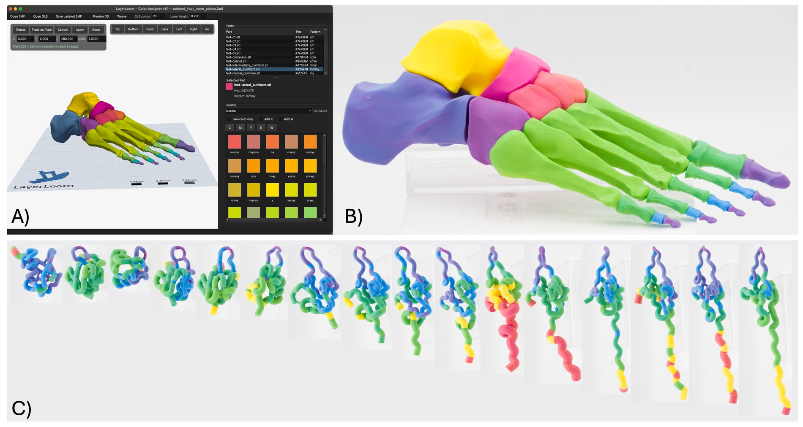

# LayerLoom

LayerLoom is an experimental Python toolkit for expanding the apparent color
palette of multi-material FFF prints. It imports 3MF/GLB models, assigns
palette colors, and generates woven multi-material 3MF files where color is
encoded as repeated layer schedules rather than as one direct filament per
visible color.

The goal is practical: produce more apparent colors from ordinary loaded
filaments without custom color-mixing hardware, custom filament fabrication, or
a weaving-aware slicer.

This branch prepares **0.6.4a4**, an unpublished test candidate. Follow the
instructions supplied with that build. **Help → Copy diagnostics** identifies
your version; the draft's validation report records completed and pending checks.

LayerLoom starts in **Arrange**, with a pixelated Benchy design on the empty
build plate. Choose **Try the example** or **Open a model** to load geometry.
Loading either example keeps the current mode. Turn on **Paint** in the main
toolbar when you want to edit surfaces; turn it off to return to Arrange.
Both modes share the same model, colors, and placement. Save `.llpaint` to keep
editable paint; **Export geometry 3MF…** converts those colors into physical
filament geometry with no per-face paint in the printable output.



*LayerLoom application examples: GUI assignment, printed multi-material color,
and scientific visualization workflows.*

## Status

LayerLoom is alpha research software. It is useful, but the public API is not
stable yet. Expect file-format edge cases and slicer-specific quirks.

LayerLoom outputs are standard 3MF files intended for ordinary slicer workflows,
but they are not full project round-trips for vendor-specific slicer files.

## Install And Open LayerLoom

The source launchers now install a private, pinned Python and the GUI dependencies
for you. **You do not need to install Python, Git, Node, or Homebrew first.**
The first setup needs an internet connection; later launches work offline.

1. Choose **Code → Download ZIP** on this GitHub page. In Downloads, double-click
   the ZIP on a Mac, or right-click it and choose **Extract All** on Windows.
   Open the extracted folder containing this README and the launchers.
2. Open the launcher in the extracted folder:
   - macOS: **Launch LayerLoom.command**
   - Windows x64: **Launch LayerLoom.bat**
   - Linux x64: run `bash "Launch LayerLoom.sh"` from the extracted folder.
3. Wait for setup to finish. The source launcher displays a terminal window;
   you normally do not need to type commands into it.
4. Click **Try the example**, then **Export geometry 3MF…**. **Woven apparent
   colors** and **0.16 mm** are selected for this tutorial. Check those values
   and confirm the settings. Then
   choose a `.3mf` filename in Documents, and wait for the completion message.
   Use that same layer height for first and subsequent layers in your slicer.

Keep the extracted folder and reopen the same launcher next time. If the Mac
launcher is blocked or will not execute, the [installation guide](docs/install.md#macos)
includes a short Terminal fallback that does not require knowing any Python.

Read the [installation guide](docs/install.md) for first-open security prompts,
repair, and Linux graphics requirements. Existing system Python installations
and repository `.venv` folders are not used or changed by these launchers.

### Standalone Mac App — Release Validation In Progress

The standalone Mac release is being prepared as an **unpublished draft**.
Draft assets are visible only to maintainers with repository write access;
public users should use the source launchers above until a desktop release is
published. A draft or a passing build does not establish that the required
[first-open and beginner checks](packaging/macos/RELEASE_CHECKLIST.md) are complete.

Desktop artifacts are separate DMGs for **Apple Silicon (macOS 14+)** and
**Intel (macOS 15+)**. To identify your Mac, choose **Apple menu → About This Mac**:
an Apple M-series chip uses `arm64`; an Intel processor uses `x86_64`.
The DMGs include Python and required libraries. Copy the app to Applications,
open it, and follow the illustrated [Mac first-open guide](docs/mac_first_open.md).
These free builds are ad-hoc signed without Apple notarization, so macOS may
require approval under **Privacy & Security**. GitHub's **Source code (zip)**
asset contains scripts and source, not a ready-to-open Mac app.

### Contributors And Command-Line Users

Use the [source/developer instructions](docs/install.md#developer-installation)
for a reproducible environment and command-line tools. `layerloom-doctor` checks
dependencies, native 3MF initialization, palettes, and tutorial files;
`layerloom-doctor --render` also checks the Qt/VTK graphics stack.

## Beginner Tutorial And Examples

Start with the walkthrough in [docs/tutorial.md](docs/tutorial.md). It includes
a first-run checklist and uses two CMY sample inputs in [examples/](examples/):

- [examples/tutorial_cmy_cubes.3mf](examples/tutorial_cmy_cubes.3mf): a basic
  cyan/magenta/yellow cube example with pre-tagged weave patterns.
- [examples/tutorial_cmy_benchy_cutup.3mf](examples/tutorial_cmy_benchy_cutup.3mf):
  a pre-labeled cut-up 3DBenchy example using only cyan, magenta, and yellow
  tokens.

For a short Paint demonstration, load the cubes, turn on **Paint** in the main
toolbar, choose **Surface select**, click a surface, choose a color, and click
**Apply paint**. Try Undo and Redo, then **Save paint…** to a `.llpaint` file
and reopen it with **Open…**. Export the
printable `.3mf` at the tutorial's selected **0.16 mm**. The editable project
keeps your paint; the printable file converts it into separate filament geometry.
The [tutorial](docs/tutorial.md) explains the slicer settings and limitations.

Start with the cubes before trying larger models. The first export also compiles
its geometry search code, so leave it running while progress advances.
Use **Help → Load the Benchy example** for the larger CMY sample. It selects a
4,096 MiB estimated export budget; the cubes and ordinary models use 2,048 MiB.
The export summary shows the active budget. This is a planning estimate for
additional work, not a limit on total app memory or a guarantee of speed. Paint's
**Save paint…** action saves the editable project, and **Export geometry 3MF…**
creates the file to slice. The [Paint workflow and limits](src/layerloom/PAINT_PROTOTYPE.md)
describe selection tools, sampling detail, cancellation, and memory budgeting.

## Palette Options

The default `Normal` palette uses LayerLoom's nominal model-generated colors.
The optional `Calibrated CMY Normal (core065)` palette uses measured printed
CMY colors from the core065 gamut analysis where available, falling back to
nominal colors for unmeasured recipes. When this palette is active, GLB/3MF
source colors are matched against the measured printed colors, so imported
colors choose the recipe expected to print closest rather than the recipe whose
nominal screen color is closest.

## Command Line Tools

These commands are for the developer environment described in the
[installation guide](docs/install.md#developer-installation). Run them with
`uv run --no-sync` from the source folder; the beginner launchers manage a
separate private environment and do not add commands to your system PATH.

Check whether the install is ready for the tutorial/GUI path:

```bash
uv run --no-sync layerloom-doctor
```

Normalize a 3MF into LayerLoom's generic internal 3MF form:

```bash
uv run --no-sync layerloom-normalize input.3mf --output normalized.3mf
```

Generate a woven 3MF:

```bash
uv run --no-sync layerloom-weave --input input.3mf --step 0.08 --output output_woven.3mf
```

By default, LayerLoom makes the first weave layer a single filament color and
automatically chooses the color with the largest footprint on the model base.
Use `--first-layer-color c` (or another filament token) to choose it explicitly,
or `--first-layer-color off` to retain the repeating pattern on the first layer.

Run the headless GLB-to-woven workflow, intended for colored GLB/GLTF exports
from tools such as ChimeraX:

```bash
uv sync --managed-python --locked --extra gui --extra headless
uv run --no-sync layerloom-headless protein.glb
uv run --no-sync layerloom-headless protein.glb --output ~/Downloads/protein_woven.3mf --orientation-quality thorough
```

By default, `layerloom-headless` imports up to about 20 GLB color groups, matches
them to the `Normal` palette, safely attempts mesh repair, searches for a
support-saving orientation, fits the footprint into a 180 x 180 mm box, weaves at
0.08 mm, and writes the final woven 3MF to `~/Downloads`.

Generate benchmark geometry:

```bash
uv run --no-sync layerloom-simplified-speed-suite --help
uv run --no-sync layerloom-benchmark-suite --help
```

## How LayerLoom Works

LayerLoom shifts color planning into geometry:

1. Normalize the input model into a generic internal 3MF.
2. Preserve best-effort display names, source color metadata, and weave tokens.
3. Assign each editable part a weave signature such as `cy`, `yyyc`, or `cym`.
4. Slice selected geometry into horizontal Z-bands at the chosen weave height.
5. Regroup bands into per-filament output objects such as `all_cyan`,
   `all_magenta`, and `all_yellow`.
6. Open the resulting 3MF in a standard slicer and assign those objects to the
   physical filaments loaded in the printer.

Add `__NOWEAVE__` to a part name to exclude that part from slicing and color
grouping. LayerLoom carries the mesh and its full name through as an independent
output object, so it remains separately selectable and recolorable in the slicer.

LayerLoom normalizes incoming 3MFs before editing:

- resolves build items, components, transforms, and production-extension child models
- flattens reachable geometry into editable mesh parts
- preserves best-effort display names and color/pattern metadata
- writes LayerLoom-style generic 3MF outputs rather than preserving full slicer project semantics

## Slicer Compatibility

LayerLoom 3MF outputs have been opened and sliced successfully in:

- OrcaSlicer
- Bambu Studio
- PrusaSlicer
- Ultimaker Cura 5.12.0

For Cura, disable automatic object drop-to-plate behavior before opening woven
LayerLoom outputs. Otherwise Cura may reinterpret the intentional vertical
banding/placement in a way that breaks the woven geometry.

More setup notes are in
[docs/slicer_compatibility.md](docs/slicer_compatibility.md). Install and
platform troubleshooting is in [docs/install.md](docs/install.md).

## Layer Height Rules

Use the same slicer layer height as the LayerLoom weave height. The first layer
height should be an integer multiple of the weave height so slicer layers stay
aligned to woven Z-bands.

Examples:

| Weave height | Valid first layer examples | Avoid |
| --- | --- | --- |
| `0.08 mm` | `0.08 mm`, `0.16 mm`, `0.24 mm` | `0.20 mm` |
| `0.12 mm` | `0.12 mm`, `0.24 mm` | `0.20 mm` |
| `0.16 mm` | `0.16 mm`, `0.32 mm` | `0.20 mm`, `0.24 mm` |
| `0.20 mm` | `0.20 mm`, `0.40 mm` | `0.24 mm` |

For example, if the weave height is `0.08 mm`, a `0.16 mm` first layer is fine,
but `0.20 mm` is not because it cuts through the weave schedule at a half-step.

## Practical Caveats

- LayerLoom produces apparent woven colors, not full-color material mixing.
- The calibrated CMY palette improves display and matching for measured CMY
  recipes, but it is still specific to the measured printer/material/lighting
  workflow behind the core065 analysis.
- Broad flat top and bottom surfaces reveal layer striation more strongly than
  steep or vertical surfaces.
- High-contrast filament combinations show woven layers more readily than
  lower-contrast combinations.
- Changing the target weave pattern requires regenerating geometry.
- Vendor-specific 3MF features such as slicer modifiers, textures, and project
  settings are not guaranteed to survive normalization.
- Thin features near weave-band boundaries may need inspection after weaving.

## Repository Layout

```text
src/layerloom/
  3mf_gui_v65.py              # current GUI implementation
  gui_app.py                  # stable GUI command wrapper
  cli.py                      # stable CLI wrappers
  normalize_3mf_import.py     # canonical 3MF import normalizer
  weave.py                    # woven 3MF generation pipeline
  palettes/                   # packaged palette JSON files
  examples/                   # packaged tutorial 3MF files used by Load Example
  legacy/                     # older/experimental code
examples/
  tutorial_cmy_cubes.3mf      # beginner CMY sample input
  tutorial_cmy_benchy_cutup.3mf
tests/
  test_smoke.py               # lightweight import/package checks
```

## Large Files

Generated 3MF/STL/GLB files are intentionally ignored by git. The tiny tutorial
fixtures in [examples/](examples/) are the exception. Keep large test models,
slicer exports, and generated benchmark outputs outside the tracked repo or
publish them separately as release assets or Zenodo datasets.

Raw photographs, calibrated TIFF exports, manuscript figure workspaces, and
one-off analysis outputs are also intentionally kept out of the public software
repo. See [docs/release_and_zenodo.md](docs/release_and_zenodo.md) for the
release checklist and archival DOI workflow.

## Citation And DOI
(preprint)
Beruldsen, Finn, Existing Multi-Material FFF Printers Are Sufficient For (Near) Arbitrary Coloration. Available at SSRN: https://ssrn.com/abstract=6876564 or http://dx.doi.org/10.2139/ssrn.6876564

## License

MIT. See `LICENSE`.
