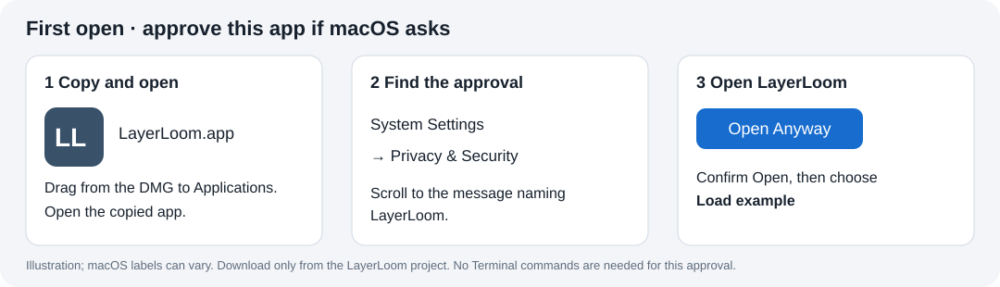

# First open on a Mac

This guide is for **LayerLoom.app from a desktop DMG**. The standalone release
is currently an **unpublished draft**, visible only to maintainers with
repository write access. Public users can use the [source launcher](install.md#download-and-run-the-source).

Desktop builds have an ad-hoc signature without Apple notarization. First-open
approval may be needed for each downloaded release. These instructions do not
mean that browser-quarantine or first-time-user testing has already passed;
maintainers must record those checks before publishing the draft.

## Choose and copy the app

1. Choose **Apple menu → About This Mac**. Note the macOS version and the chip
   or processor.
2. Use the `arm64` DMG for an **Apple M-series chip** on macOS 14 or newer.
   Use the `x86_64` DMG for an **Intel processor** on macOS 15 or newer.
3. Open the DMG and drag **LayerLoom.app** to Applications, or another folder
   you can write to. Open that copied app from Finder.

## Approve a blocked download

If the alert says the developer cannot be verified or Apple cannot check the
app, confirm that this copy came from the LayerLoom project. Then:

1. Dismiss the alert without moving the app to Trash.
2. Open **Apple menu → System Settings → Privacy & Security** and scroll down
   to **Security**.
3. Find the message naming **LayerLoom**. Choose **Open Anyway**; some versions
   first show **Open** in this section. Confirm **Open** or **Open Anyway** in
   the resulting dialog and enter your Mac login password if asked.

The button is available for about an hour after an attempted launch. If no
LayerLoom message appears, try opening the copied app again, then return to
Privacy & Security. This approves that app; subsequent launches use an ordinary
double-click. On macOS 15 Sequoia and 26 Tahoe, use this Settings route instead
of relying on a Finder right-click shortcut. The Settings route also applies
to macOS 14 Sonoma.

Apple documents the procedure in [Safely open apps on your Mac](https://support.apple.com/en-us/102445)
and its version-specific guides for [macOS 15](https://support.apple.com/en-gb/guide/mac-help/mh40617/15.0/mac/15.0)
and [macOS 26](https://support.apple.com/en-gb/guide/mac-help/mh40617/26/mac/26).
Button wording can vary with the exact macOS update.

If approval remains unavailable, a managed-computer policy may prevent it;
contact the administrator. An **app is damaged** or **will damage your computer**
message is different: stop, obtain a fresh project download, and report the
exact message if it persists. Do not disable Gatekeeper or remove quarantine
attributes to make the test pass.

## Make your first woven model

1. Click **Try the example**. Four CMY cubes appear in Paint.
2. Click **Export geometry 3MF…**. The tutorial selects **Woven apparent
   colors** and **0.16 mm** automatically. Check those values and confirm.
   The first export may take longer while geometry search code compiles.
3. Choose a `.3mf` filename in Documents and wait for the completion message.
   Use **Show in Finder** to locate the output.
4. Open it in your slicer, keep its parts aligned, and assign the `all_…`
   objects to the corresponding filaments. For this first example, use
   **0.16 mm for both normal and first layers**, with adaptive layers disabled.

## Try painting

With the cubes open, choose **Surface select**, click a surface, pick a color,
and click **Apply paint**. Try Undo and Redo. Choose **Save paint…** to keep an
editable `.llpaint` project, then reopen it with **Open…**. Export a separate
`.3mf` for slicing: it contains the physical filament geometry generated from
those colors. It does not retain editable face paint. See the [tutorial](tutorial.md)
for selection tools, the larger Benchy example, and export limits.

These Paint instructions apply to the **0.6.4a3 candidate**; the older 0.6.3
Mac draft does not include this workspace. Use **Help → Copy diagnostics** to
check the version being tested. Use a DMG labeled **0.6.4a3** for this guide;
the previous 0.6.4a2 candidate can show the bundled Benchy in gray.

Python and the required libraries are inside the app. Once first-open approval
is complete, you can run the example offline. Outputs go to the folder you
choose. For help, use **Help → Copy diagnostics** or **Help → Open logs**.
